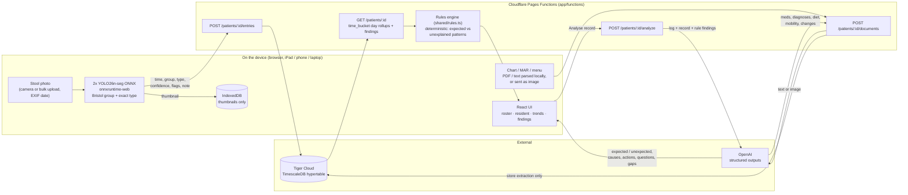

# Take Shit Seriously — bowel-health early warning for care teams

> **The pitch.** In long-term care, a bowel problem is usually the first sign that something is wrong, and the last
> thing anyone charts properly. A CNA snaps a photo on the unit iPad; a model on the device scores it on the Bristol
> scale and the photo never leaves the room. The app lines the log up against the resident's meds, diagnoses and
> menu, explains the patterns that make sense (opioids plus low fibre, loose stools on an antibiotic) and flags the
> ones that don't, so a nurse investigates on day two instead of admitting for dehydration on day six.

Hackathon project (yes, the name is a pun): help nurses, CNAs and wellness staff in long-term care notice a bowel problem
days before it becomes a fall, a dehydration admission or a C. difficile outbreak.

**How it works**

1. A CNA photographs a stool with the unit iPad (or bulk-uploads several days of photos).
   Two small YOLO26n-seg models classify it **on the device** (Bristol group + exact type, mask
   overlay). The photo never leaves the device; only the score, time and quick-tap flags are stored.
2. Charts, MARs and menus are dropped into the resident's record box. They are parsed on the device
   (PDF/text) or sent as an image, and OpenAI structures them into medications, diagnoses, diet,
   mobility and recent changes.
3. A deterministic **rules engine** cross-checks the bowel log with the record and produces findings
   with a plain-language *why* and next steps: constipation explained by low fibre + opioids, loose
   stools expected on an antibiotic, or — the important one — a pattern with **no documented
   explanation** that needs investigation.
4. **Analyse record** asks the LLM to reason over log + record + rule findings and return expected vs
   unexpected observations, likely causes, prioritised actions, questions for the team and data gaps.
5. Trends live in **Tiger Cloud** (TimescaleDB hypertable, per-day `time_bucket` rollups). The UI is
   PointClickCare-inspired and works on iPad, phone and laptop. Hosted on Cloudflare Pages.



```
app/        the web app (Vite + React + TS, Cloudflare Pages Functions)   -> app/README.md
demo/       five synthetic residents, their records, EXIF-dated photos    -> demo/README.md
models/     stool_3group_v4.onnx / stool_v4.onnx (+ .pt)                   -> ship the ONNX files
training/   Colab notebooks + Roboflow COCO -> YOLO converter
data/       datasets (git-ignored)
docs/       dataset attribution (CC BY 4.0) + disclaimer
```

## Quick start

Pitch deck for judges: open `index.html` at the repo root (arrow keys to move, `F` for fullscreen). Screenshots live in `pitch/`.

```bash
cd app && npm install
cp .dev.vars.example .dev.vars   # DATABASE_URL (Tiger Cloud), OPENAI_API_KEY
npm run preview                  # http://localhost:8788 -> Settings -> Load demo residents
python3 ../demo/stamp_exif.py    # re-date the demo photos to end today (pip install piexif pillow)
```
Deployment to Cloudflare Pages: see `app/README.md` (root dir `app`, build `npm run build`, output `dist`).

## Models (browser-side, verified)

| | |
|---|---|
| `models/stool_3group_v4.onnx` | 3 classes: 0 constipated (1–2), 1 normal (3–5), 2 loose (6–7). **Headline model.** |
| `models/stool_v4.onnx` | 7 classes (Bristol 1–7). Shown only when score ≥ 0.6 and inside the headline group. |
| input / outputs | `images [1,3,640,640]` RGB/255 stretched · `output0 [1,300,38]` (`x1,y1,x2,y2,score,class,32 coeffs`) · `output1 [1,32,160,160]` protos · keep `score > 0.2` |

Per-photo accuracy (class of the top detection), measured Oct 17 2026 on photos never used in training:

| | curated test split (108 photos, smartgut) | crowd-sourced phone photos (73, Bristol-Stool-Boost valid+test) |
|---|---|---|
| 3-group headline correct | 82 % (v3: 83 %) | **70 %** (v3: 63 %) |
| exact type correct | 74 % (v3: 69 %) | **49 %** (v3: 30 %) |
| exact type within ±1 | 87 % (v3: 81 %) | 79 % (v3: 67 %) |
| app policy: type shown / correct when shown | 81 % / 83 % | 49 % / **69 %** (v3: 30 % / 50 %) |

Still weak: hard stools (types 1–2) on real backgrounds, group correct on 5 of 11. Training data: the
"stool classification" dataset by smartgut (Roboflow Universe, CC BY 4.0), de-duplicated (294 duplicate photos
removed) and re-split 75/12.5/12.5, plus 232 crowd-sourced "Bristol-Stool-Boost" photos whose masks were
pseudo-labelled by the v3 model (`training/pseudo_label_boost.py`, licence of that set unverified, see
`docs/DATASET_ATTRIBUTION.md`). Retrain with the `*_v4*` notebooks in `training/`; cell 6b reports the
real-world score. To ship a new model, give it a new file name in `app/public/models/` and bump `CACHE` in
`app/src/lib/model.ts` so devices drop their cached copy.

## Privacy model

- Stool photos: processed in the browser with onnxruntime-web; thumbnails stay in that browser's
  IndexedDB; the server only ever sees `{time, group, type, confidence, flags, note}`.
- Records: text is sent to OpenAI for structuring and stored in the database; chart *photos* are sent
  to OpenAI vision but not stored (only the transcription/extraction is).
- Not a medical device. Decision support only; the disclaimer is shown in the app footer and settings.

## Technology used

**Frontend (app/src)**
- React 19 + TypeScript, Vite 8, Tailwind CSS 4, React Router 7
- onnxruntime-web (WebAssembly) to run the YOLO26n-seg models in the browser
- pdf.js (`pdfjs-dist`) to read chart PDFs on the device; `exifr` to pull capture dates from photo EXIF
- Recharts for the trend charts; IndexedDB for on-device thumbnails

**Backend (app/functions)**
- Cloudflare Pages + Pages Functions (Workers runtime), deployed and run locally with Wrangler
- Tiger Cloud (managed TimescaleDB / PostgreSQL) via `postgres` (postgres.js): hypertable + `time_bucket` rollups
- OpenAI API with strict structured outputs (`gpt-6-luna` by default, env `OPENAI_MODEL`): record extraction, vision transcription, record analysis
- Deterministic rules engine in TypeScript (`app/shared/rules.ts`), shared between server and client

**Models and training (models/, training/)**
- Ultralytics YOLO26n-seg, trained on Google Colab (A100 / L4 / T4) and exported to ONNX
- Roboflow Universe datasets ("stool classification" by smartgut, CC BY 4.0; Bristol-Stool-Boost), COCO -> YOLO-seg converter and v3-based pseudo-labelling in Python (NumPy, Pillow)

**Demo data (demo/)**
- Five synthetic residents with records; Python (`piexif`, Pillow) re-dates the demo photos' EXIF to end today
